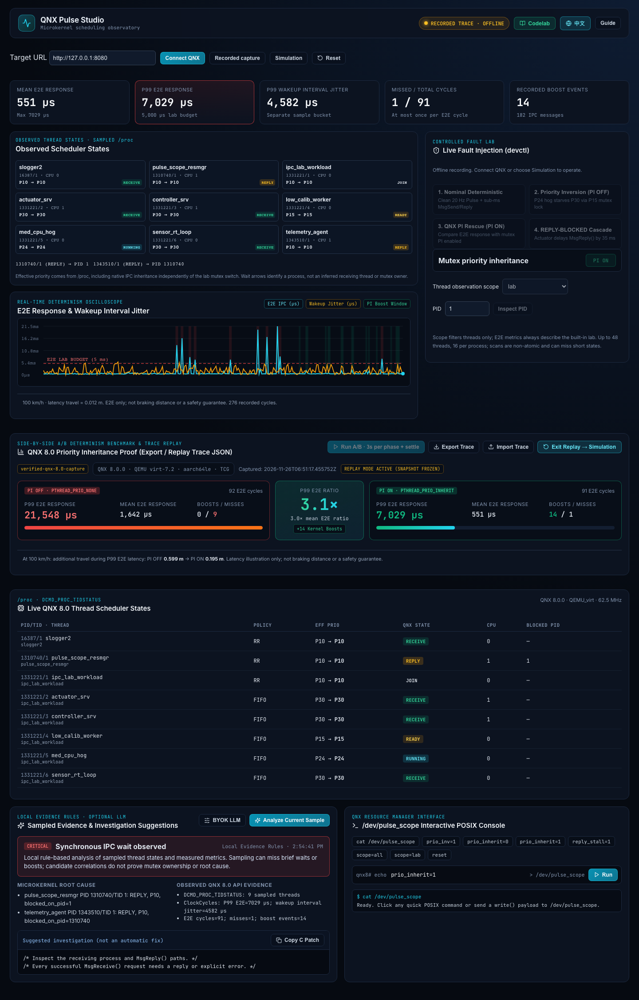
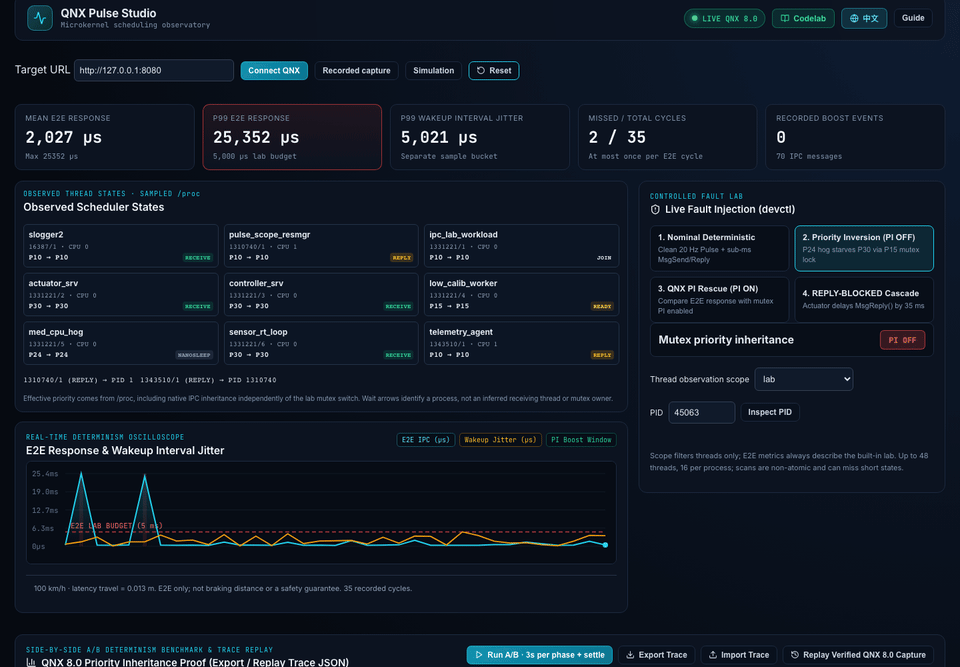

# QNX Pulse Studio

> **Real-Time Microkernel IPC, Resource Manager & Deterministic Scheduling Observatory for QNX OS 8.0**
> Built for the **QNX Global Hackathon** — Primary Track: **Developer Tooling & Host Tools**
> Bonus Targets: **Best Use of QNX-Specific Technologies** & **Best Codelab / Tutorial**
>
> - ⚡ **Live Interactive Studio (Zero-Install Demo + Verified QNX 8.0 Capture Replay)**: [`https://pan609.github.io/qnx-pulse-studio/`](https://pan609.github.io/qnx-pulse-studio/)
> - 📘 **Interactive Step-by-Step Codelab (Zero Hardware on Apple Silicon)**: [`https://pan609.github.io/qnx-pulse-studio/codelab/`](https://pan609.github.io/qnx-pulse-studio/codelab/)

---

## Recorded QNX OS 8.0 benchmark (QEMU TCG)

P99 E2E: PI OFF 21,548 µs / PI ON 7,029 µs. Missed cycles: 9/92 and 1/91.

| Mode | E2E cycles | Mean E2E (µs) | P99 E2E (µs) | P99 wakeup interval jitter (µs) | Missed E2E cycles (>5 ms) | Recorded boost events |
|---|---:|---:|---:|---:|---:|---:|
| PI OFF | 92 | 1642 | 21548 | 5215 | 9 | 0 |
| PI ON | 91 | 551 | 7029 | 4582 | 1 | 14 |

Captured 2026-11-26T06:51:17.455744Z. One run on one host; QEMU TCG has no hardware real-time guarantee. E2E and jitter use independent 128-sample windows; misses/max are since reset. This replaces the initial release's invalid mixed-metric benchmark.

[Original capture](studio-ui/public/captures/qnx8-qemu-verified-trace.json) · [Target proof](docs/qnx8-verified-capture-proof.txt) · [Checksums](docs/capture-sha256.json) · [HTTP/JSON smoke result](docs/target-smoke.json)




---

## Why QNX Pulse Studio?

QNX OS 8.0's microkernel architecture—synchronous **Message Passing IPC** (`MsgSend`/`MsgReceive`/`MsgReply`), asynchronous **Pulses** (`SIGEV_PULSE`), user-space **Resource Managers** (`/dev/*`), and strict **`SCHED_FIFO` Priority Inheritance**—is what powers mission-critical automotive, robotics, and medical systems.

Yet observing microkernel scheduling behavior, diagnosing `STATE_REPLY` cascades, or proving Priority Inheritance under CPU contention has traditionally required heavyweight legacy IDEs or raw CLI `pidin`/`tracelogger` output.

**QNX Pulse Studio** pairs a **native QNX 8.0 C microkernel telemetry stack** (running inside QNX 8.0 on QEMU or Raspberry Pi 5) with a **modern zero-install Web Observatory & rule-based Trace Analyst (optional BYOK LLM)** on your host machine:

- **Live Microkernel IPC Topology Graph**: Visualize `CLOCK_MONOTONIC` → `SIGEV_PULSE` → `sensor_rt_loop` → `controller_srv` → `actuator_srv` synchronous message hops and priority-inheritance boosts in real time.
- **Deterministic Oscilloscope**: Plot hardware-timed `ClockCycles()` E2E IPC latency and wakeup jitter (µs) against a 5 ms hard real-time deadline.
- **Live Fault Injection via `devctl()`**: Toggle `PTHREAD_PRIO_INHERIT` vs `PTHREAD_PRIO_NONE`, inject a medium-priority CPU hog to trigger classic **Priority Inversion**, or stall `MsgReply()` to observe **`REPLY-BLOCKED`** cascades live.
- **Interactive `/dev/pulse_scope` Console**: Send real POSIX `read()` / `write()` / `devctl()` commands directly from your browser into our QNX 8.0 Resource Manager.
- **Local Trace Analyst**: Inspects captured `/proc/<pid>/as` thread states (`DCMD_PROC_TIDSTATUS`) and `ClockCycles()` jitter to explain root causes and suggest further QNX C API investigations (works offline with zero API keys, with optional BYOK LLM mode).

---

## Architecture

```
┌───────────────────────────────────────────────────────────────────────────┐
│                    QNX OS 8.0 Target (QEMU aarch64le / RPi 5)             │
│                                                                           │
│  [CLOCK_MONOTONIC] ──SIGEV_PULSE (20Hz)──► [sensor_rt_loop · FIFO P30]    │
│                                                 │ MsgSend() / MsgReply()  │
│  [low_calib_worker · P15→P30 PI] ◄──Mutex──►    ▼                         │
│  [med_cpu_hog · FIFO P24]                  [controller_srv · FIFO P25]    │
│                                                 │ MsgSend() / MsgReply()  │
│                                                 ▼                         │
│                                            [actuator_srv · FIFO P20]      │
│                                                 │                         │
│                        devctl(DCMD_PULSE_SCOPE_*)                         │
│                                                 ▼                         │
│       ┌──────────────────────────────────────────────────────────┐        │
│       │   /dev/pulse_scope  (pulse_scope_resmgr.c)               │        │
│       │   • resmgr_attach() / iofunc_* / custom devctl()         │        │
│       │   • /proc/<pid>/as (DCMD_PROC_TIDSTATUS) scanner         │        │
│       │   • ClockCycles() + SYSPAGE_ENTRY(qtime)->cycles_per_sec │        │
│       └─────────────────────────┬────────────────────────────────┘        │
│                                 │ devctl(SNAPSHOT / SET_CFG)              │
│                                 ▼                                         │
│                      [telemetry_agent.c :8080]                            │
└─────────────────────────────────┼─────────────────────────────────────────┘
                                  │ QEMU hostfwd tcp::8080-:8080
                                  ▼
┌───────────────────────────────────────────────────────────────────────────┐
│              Host Workstation (macOS Apple Silicon / Linux / Win)         │
│   QNX Pulse Studio Web UI (React + TypeScript + Canvas Oscilloscope)      │
│   • Recorded capture by default; explicit live connection or synthetic simulation   │
└───────────────────────────────────────────────────────────────────────────┘
```

---

## Genuine QNX 8.0 APIs Used

| Component | Source File | QNX 8.0 Microkernel APIs |
| :--- | :--- | :--- |
| Resource Manager | [`qnx-target/src/pulse_scope_resmgr.c`](qnx-target/src/pulse_scope_resmgr.c) | `dispatch_create()`, `resmgr_attach()`, `iofunc_func_init()`, `iofunc_attr_init()`, `devctl()` (`__DIOT`/`__DIOF`/`__DION`), `DCMD_PROC_TIDSTATUS`, `ClockCycles()`, `SYSPAGE_ENTRY(qtime)->cycles_per_sec`, `procmgr_ability()` |
| Real-Time IPC Workload | [`qnx-target/src/ipc_lab_workload.c`](qnx-target/src/ipc_lab_workload.c) | `ChannelCreate()`, `ConnectAttach()`, `MsgSend()`, `MsgReceive()`, `MsgReply()`, `MsgReceivePulse()`, `SIGEV_PULSE_INIT`, `timer_create(CLOCK_MONOTONIC)`, `SCHED_FIFO`, `PTHREAD_PRIO_INHERIT` vs `PTHREAD_PRIO_NONE` |
| Native Telemetry Bridge | [`qnx-target/src/telemetry_agent.c`](qnx-target/src/telemetry_agent.c) | QNX POSIX sockets (`-lsocket`), `devctl()` IPC into `/dev/pulse_scope`, `uname()` target metadata |
| Build & Target Image | [`qnx-target/Makefile`](qnx-target/Makefile), [`qnx-target/qnx-pulse-studio.build`](qnx-target/qnx-pulse-studio.build) | `qcc -Vgcc_ntoaarch64le`, `mkqnximage --type=qemu --arch=aarch64le` |

---

## Quick Start (Zero Hardware — Apple Silicon macOS / Linux + QEMU)

### Prerequisites
- Free **QNX Everywhere (QNX SDP 8.0 Non-Commercial)** license from `https://www.qnx.com/getqnx`
- **Colima** (`brew install colima && colima start --cpu 4 --memory 4 --disk 30 --vm-type=vz --vz-rosetta`) or Docker Desktop (Rosetta 2 enabled on Apple Silicon for `linux/amd64` QNX host tools)
- **QEMU 10+** (`brew install qemu` on macOS)
- **Node.js 20+** (for the Host Web UI)

### 1. Install QNX SDP 8.0 & QEMU VirtIO Packages into a Persistent Host Volume (Zero Secrets in Docker Layers)
```bash
export QNX_USER="you@example.com"
export QNX_PASSWORD="your-myqnx-password"
export QSC_INSTALLER="$HOME/Downloads/qnx-setup-2.0.4-*-linux.run"

./scripts/setup-qnx-sdp.sh
```

### 2. Build the Bootable QNX 8.0 AArch64 QEMU Image & Cross-Compile Target Binaries
```bash
./scripts/build-qnx-image.sh
./scripts/build-target.sh
```

### 3. Boot QNX 8.0 (`aarch64le`) on macOS QEMU
```bash
./scripts/run-qemu-macos.sh
# Boots QNX 8.0.0 QEMU_virt aarch64le with virtio-blk, vtnet0 DHCP + hostfwd :8022/:8080
```

### 4. Deploy & Start Pulse Studio Inside QNX 8.0
In a second terminal:
```bash
./scripts/deploy-to-qnx.sh
```
Verify directly from your host:
```bash
curl -s http://127.0.0.1:8080/api/health
```

### 5. Launch the Host Observatory UI
```bash
cd studio-ui
npm install
npm run dev
# Open http://localhost:5173 (recorded QNX capture by default; click Connect QNX for live data; ?demo=1 is synthetic simulation)
```

---

## Codelab / Tutorial

Read our step-by-step zero-hardware guide targeting Apple Silicon macOS & QEMU virt-7.2 / GICv2 / TCG:
👉 **[`codelab/CODELAB.md`](codelab/CODELAB.md)**

## License

Released under the [MIT License](LICENSE).

## Evidence and repeatable checks

```sh
./scripts/build-target.sh
./scripts/deploy-to-qnx.sh
python3 scripts/smoke-target.py
python3 scripts/capture-qnx-trace.py
cd studio-ui
npm ci
npm run build
npm test
```

The capture script preserves all snapshots and raw events for Nominal → PI OFF → PI ON. It cross-checks each E2E cycle, P99 and miss counter; no trace points are synthesized. Read-only replay never marks a live connection. Browser simulation is synthetic and labeled throughout. Failures of a live target do not switch sources automatically.

The source, QNX ELF binaries and trace are tied by SHA-256 in `docs/capture-sha256.json`. The proof log identifies the QNX kernel in QEMU, not a physical device. Scope controls `lab | all | pid` inspect up to 48 threads (16 per process); the E2E counters still describe the built-in workload. /proc scans are non-atomic; causal diagnosis requires native tracing to confirm owners and short transients.

The default analyzer is a local evidence rule engine, not an LLM. Optional BYOK sends selected sampled telemetry to the explicitly configured endpoint. No key is stored. Suggestions require engineering review. The 100 km/h ruler shows extra travel during measured E2E latency only, not total braking distance or a vehicle safety guarantee.

For an HTTPS hosted Studio unable to access an HTTP localhost target, run `npm run dev` locally. QEMU forwarding is bound to loopback. No hardware timing certification is implied.

## R2 follow-up protocol checks

The bundled 276-cycle capture and `docs/capture-sha256.json` are frozen evidence from source `aae0101`; their source hashes refer to that revision. Later P2 input/iteration fixes do not rewrite the capture or remove its PI ON outlier. `docs/p2-build-sha256.json` identifies the patched C source and binaries separately.

Control accepts a flat JSON object with actual typed scalar members. Unknown scalar members are ignored; nested values, duplicate control members, malformed JSON and type mismatches are rejected without changing configuration. The minimal HTTP bridge rejects Transfer-Encoding and duplicate Content-Length headers. Focused results: `docs/p2-host-regression.json`, `docs/p2-target-regression.json`, and `docs/p2-browser-regression.json`.
