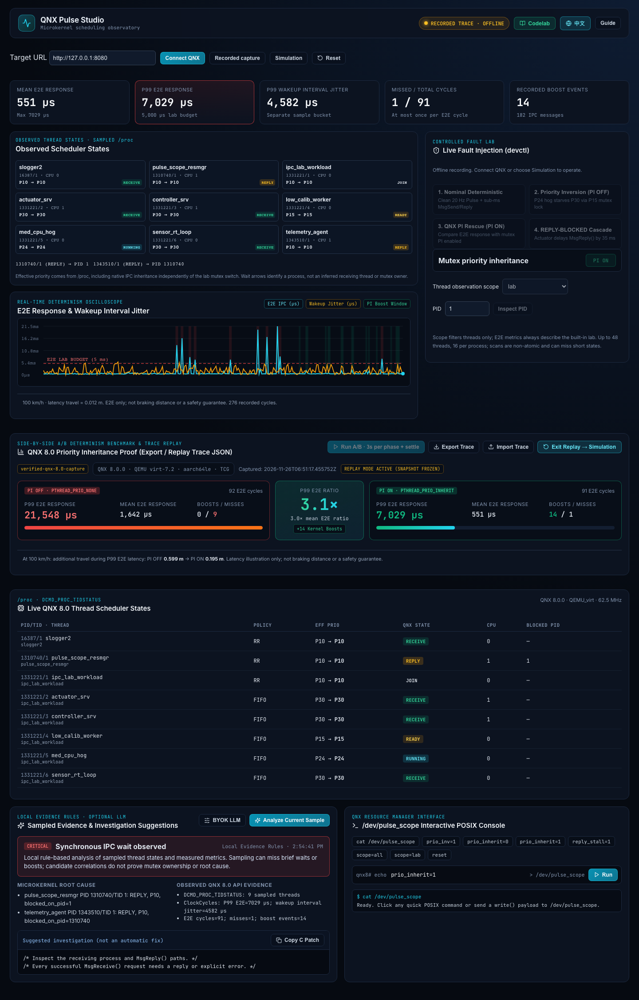
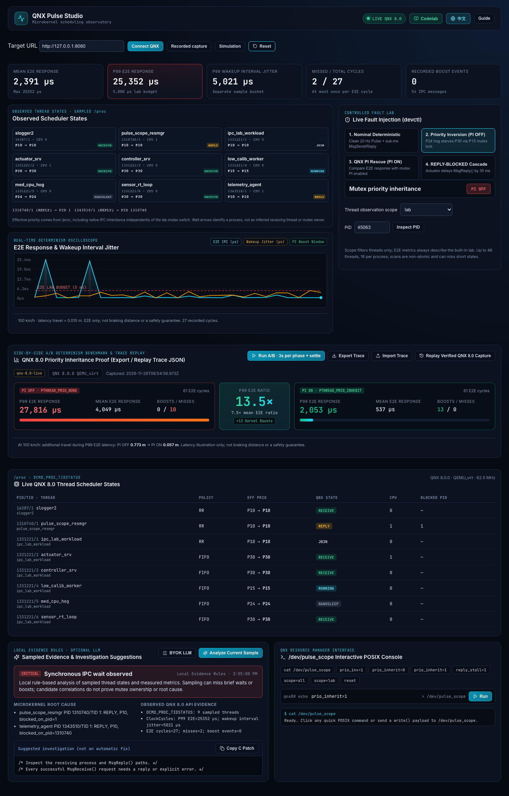
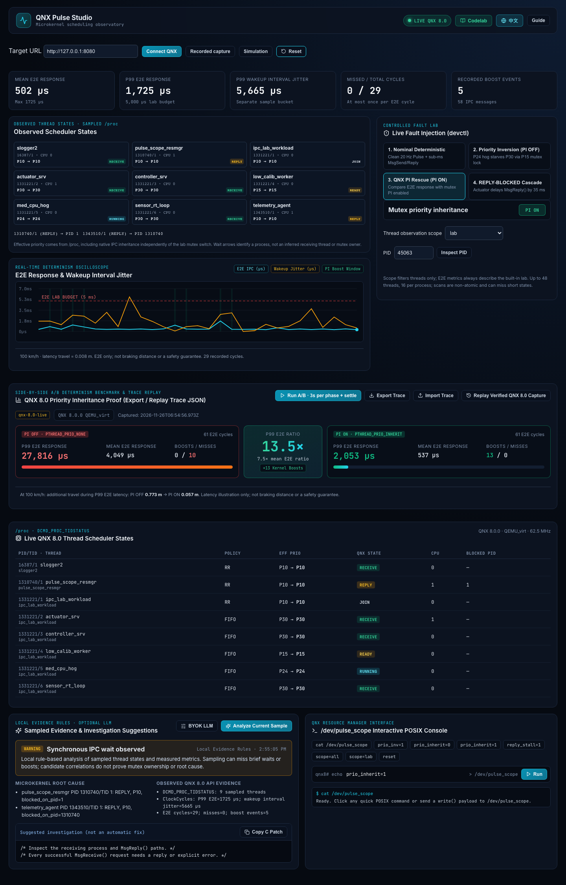
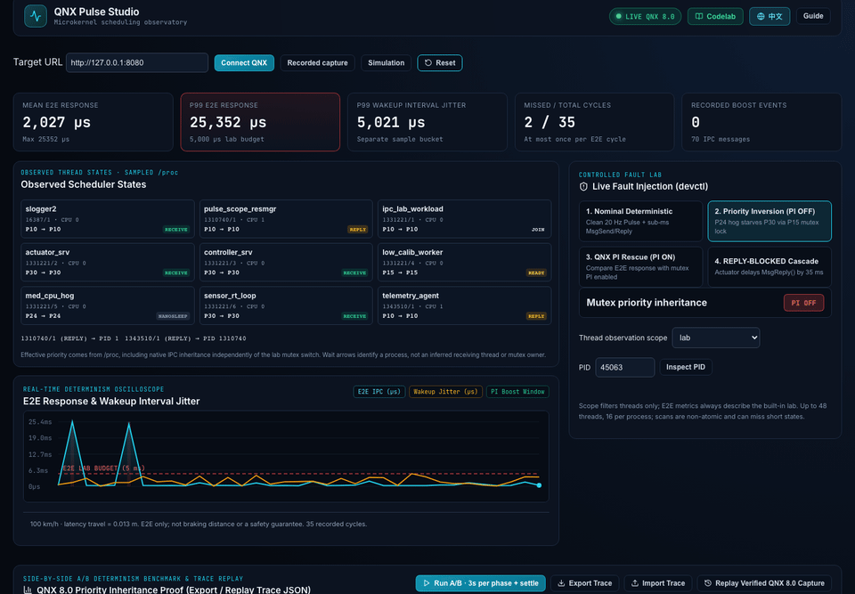

# QNX OS 8.0 on Apple Silicon — QEMU TCG Codelab

Nine steps. Read the interactive tutorial in codelab/index.html. QNX runs as an emulated aarch64le guest on virt-7.2 (GICv2), not through HVF. The Linux SDK runs under Rosetta in Colima.

## Measurement evidence
P99 E2E: PI OFF 21,548 µs / PI ON 7,029 µs. Missed cycles: 9/92 and 1/91.

This is one recorded run, not a worst-case guarantee. QEMU host scheduling can produce outliers. See ../docs/qnx8-verified-capture-proof.txt and ../docs/capture-sha256.json.

## 1. Overview & What You Will Build

```sh
uname -m
```
arm64 (Apple Silicon host; Linux host output can differ)

## 2. Claim Free QNX Everywhere (SDP 8.0) License

```sh
test -f "$QSC_INSTALLER" && echo "QSC installer exists"
```
Installer existence only. Manually confirm Accepted + Deployed in myQNX; never print the license key.

## 3. Prepare Apple Silicon Host (Colima + Rosetta 2 + QEMU)

```sh
docker run --rm --platform linux/amd64 ubuntu:22.04 uname -m
```
x86_64 (the SDK container architecture, not the QNX guest)

## 4. Headless QNX SDP 8.0 & QEMU VirtIO Package Install

```sh
test -f "$HOME/qnx-env/qnx800/qnxsdp-env.sh" && echo "SDK environment exists"
```
SDK environment exists. Actual compiler/license verification occurs at build-target.sh; existence alone is not activation proof.

## 5. Build & Boot Genuine QNX 8.0 (aarch64le) on macOS QEMU

```sh
ssh -i "$HOME/qnx-env/qnx_id_ed25519" -p 8022 root@127.0.0.1 uname -a
```
QNX noname 8.0.0 ... QEMU_virt aarch64le (observed output; build timestamp varies)

## 6. Inside the QNX 8.0 Resource Manager (/dev/pulse_scope)

```sh
curl -fsS -X POST http://127.0.0.1:8080/api/devctl -d ""
```
After deployment in the next step: JSON with total_cycles, avg_e2e_us and scope. User-space server responds through POSIX read().

## 7. Cross-Compile & Deploy the Priority Inversion Lab

```sh
curl -fsS http://127.0.0.1:8080/api/health
```
{"ok":true,"sysname":"QNX","release":"8.0.0","machine":"QEMU_virt"} (observed on this guest)

## 8. Measure E2E Response Time Without Mixing Jitter

```sh
python3 scripts/capture-qnx-trace.py
```
Saved ... qnx8-qemu-verified-trace.json; nominal=93, pi-off=92, pi-on=91 in the archived run. Counts vary with timing. Script asserts cycles, P99 and miss counts from original events.

## 9. Battle-Tested Apple Silicon Troubleshooting Matrix

```sh
python3 scripts/smoke-target.py
```
"result": "PASS"; split HTTP, rejected incomplete/oversized requests, JSON escaping, system threads. See docs/target-smoke.json for the actual record.

## Actual target UI captures





## Statistics and observation limits
E2E-only latency bucket and a separate pulse wakeup interval-jitter bucket; nearest-rank P99 over the last 128 samples, misses/max since reset. A miss is E2E > 5000 µs once per complete cycle. Wakeup interval jitter is not absolute timer lateness.
Thread scanning is bounded (48 total / 16 per process), non-atomic, and can miss brief states. SEND/REPLY arrows name a destination PID, not a mutex owner or receiving TID. Local diagnosis offers candidate correlations and never reads fault flags.
At 100 km/h, E2E × 27.78 m/s illustrates additional travel during latency only, not braking distance or vehicle safety.
